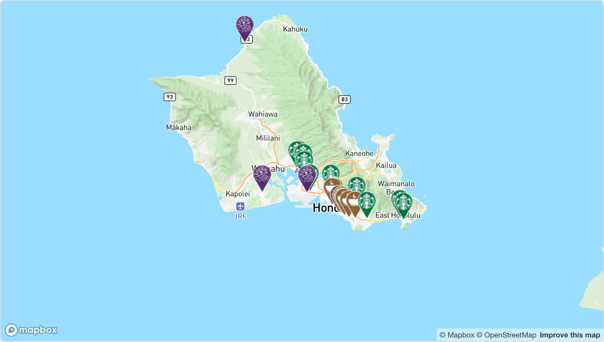
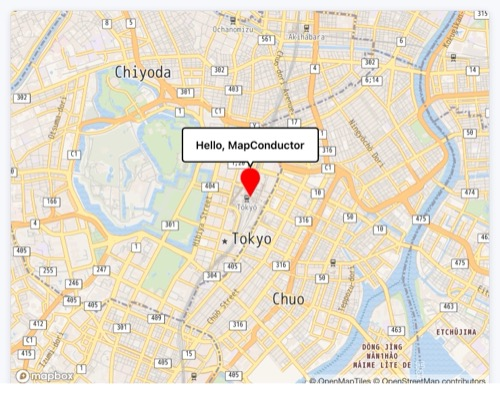

[English](https://github.com/MapConductor/react-for-mapbox/blob/main/README.md) | [日本語](https://github.com/MapConductor/react-for-mapbox/blob/main/README.ja.md) | Español (Latinoamérica)

# @mapconductor/react-for-mapbox

Proveedor de Mapbox GL JS para el SDK de React de MapConductor. Renderiza un mapa de Mapbox a través de la API de cámara, marcadores y superposiciones independiente del proveedor de MapConductor, de modo que el mismo código de aplicación también puede ejecutarse en Google Maps, MapLibre, Leaflet, OpenLayers, ArcGIS, Cesium o HERE.

## Demostración

[](https://demo-react.mapconductor.com/mapbox/map/en)

Ábrelo en la [demo en vivo](https://demo-react.mapconductor.com/mapbox/map/en): el mismo mapa de tiendas funciona con todos los proveedores y la página cambia entre ellos. El código, reducido a tres tiendas:

```tsx
import { useMemo, useState } from 'react';
import {
  createGeoPoint,
  createMapCameraPosition,
  createMarkerState,
  type MarkerState,
} from '@mapconductor/js-sdk-core';
import { InfoBubble, Markers } from '@mapconductor/js-sdk-react';
import { MapboxDesign, MapBoxMapView2D, useMapboxViewState } from '@mapconductor/react-for-mapbox';
import '@mapconductor/react-for-mapbox/style.css';

const STORES = [
  { id: 'waikiki', name: 'Waikiki', latitude: 21.2793, longitude: -157.8292 },
  { id: 'kailua', name: 'Kailua', latitude: 21.3972, longitude: -157.7394 },
  { id: 'haleiwa', name: 'Haleiwa', latitude: 21.5928, longitude: -158.1034 },
];

const INITIAL_CAMERA = createMapCameraPosition({
  position: createGeoPoint({ latitude: 21.38, longitude: -157.93 }),
  zoom: 10,
});

export default function App() {
  const mapViewState = useMapboxViewState({
    accessToken: 'YOUR_MAPBOX_ACCESS_TOKEN',
    mapDesignType: MapboxDesign.Streets,
    cameraPosition: INITIAL_CAMERA,
  });
  const [selected, setSelected] = useState<MarkerState | null>(null);
  const markers = useMemo(
    () =>
      STORES.map(store =>
        createMarkerState({
          id: store.id,
          position: createGeoPoint({ latitude: store.latitude, longitude: store.longitude }),
          extra: store,
          onClick: marker => setSelected(marker),
        }),
      ),
    [],
  );

  return (
    <div style={{ width: '100%', height: '100vh' }}>
      <MapBoxMapView2D state={mapViewState} onMapClick={() => setSelected(null)}>
        <Markers states={markers} />
        {selected && (
          <InfoBubble marker={selected}>
            <strong>{(selected.extra as (typeof STORES)[number]).name}</strong>
          </InfoBubble>
        )}
      </MapBoxMapView2D>
    </div>
  );
}
```

Reemplaza `YOUR_MAPBOX_ACCESS_TOKEN` con tu propia clave.

## Instalación

```shell
npm install @mapconductor/react-for-mapbox
```

`@mapconductor/js-sdk-core` y `@mapconductor/js-sdk-react` (usados para marcadores y otros componentes compartidos) se instalan automáticamente como dependencias. Tu código importa directamente de ambos, así que con el `node_modules` estricto (aislado) de pnpm — o siempre que prefieras declarar todo lo que importas — instálalos explícitamente:

```shell
npm install @mapconductor/react-for-mapbox @mapconductor/js-sdk-core @mapconductor/js-sdk-react
```

`mapbox-gl` viene incluido como dependencia. Los presets de estilo `mapbox://` requieren un token de acceso de tu [cuenta de Mapbox](https://account.mapbox.com/); los presets basados en OSM funcionan sin token.



## Tutorial Hello Map

La aplicación de mapa más sencilla posible, creada con MapConductor + Mapbox: haz clic en el marcador y aparecerá un globo "Hello, MapConductor". Puedes crear este mapa en los 5 pasos siguientes. Usa los estilos de openstreetmap.jp, que no requieren token de acceso, así que puedes copiar y pegar y funciona.

### Paso 1: Crea un proyecto React

Crea un proyecto React + TypeScript con Vite.

```shell
npm create vite@latest hello-map -- --template react-ts
cd hello-map
npm install
npm run dev
```

### Paso 2: Instala MapConductor (Mapbox)

Instala el paquete necesario para mostrar un mapa. Aquí usamos Mapbox, pero también puedes usar otros módulos de mapas.

```shell
npm install @mapconductor/react-for-mapbox
```

- `@mapconductor/react-for-mapbox` — componentes / hooks para Mapbox
- `@mapconductor/js-sdk-react` / `@mapconductor/js-sdk-core` se instalan
  automáticamente como dependencias.

### Paso 3: Muestra el mapa

Crea el estado del mapa con `useMapboxViewState` y renderízalo con `<MapBoxMapView2D>`. No olvides el import del CSS de estilos. Da una altura al elemento externo para que ocupe toda la pantalla.

```tsx
import {
  MapboxDesign,
  MapBoxMapView2D,
  useMapboxViewState,
} from '@mapconductor/react-for-mapbox';
import '@mapconductor/react-for-mapbox/style.css';
import { createGeoPoint, createMapCameraPosition } from '@mapconductor/js-sdk-core';

const TOKYO = createGeoPoint({ latitude: 35.6812, longitude: 139.7671 });
const INITIAL_CAMERA = createMapCameraPosition({ position: TOKYO, zoom: 14 });

export default function App() {
  const mapViewState = useMapboxViewState({
    mapDesignType: MapboxDesign.OsmBrightEn,
    cameraPosition: INITIAL_CAMERA,
  });

  return (
    <div style={{ width: '100vw', height: '100vh' }}>
      <MapBoxMapView2D state={mapViewState} />
    </div>
  );
}
```

Usa `MapBoxMapView` en lugar de `MapBoxMapView2D` para la proyección de globo.

### Paso 4: Coloca un marcador

Crea el estado del marcador con `createMarkerState` y regístralo con `<Marker>`. Escribe las superposiciones como **elementos hijos** del componente del mapa.

```tsx
import { useMemo } from 'react';
import { createMarkerState } from '@mapconductor/js-sdk-core';
import { Marker } from '@mapconductor/js-sdk-react';

// ...dentro de App...
const marker = useMemo(
  () => createMarkerState({ id: 'hello', position: TOKYO }),
  [],
);

// ...dentro de return...
<MapBoxMapView2D state={mapViewState}>
  <Marker state={marker} />
</MapBoxMapView2D>
```

### Paso 5: Muestra un InfoBubble al hacer clic

Guarda el estado de selección con `useState`, ponlo en true en el `onClick` del marcador y renderiza `<InfoBubble>` solo mientras está seleccionado. Este es el resultado final.

```tsx
import { useMemo, useState } from 'react';
import {
  MapboxDesign,
  MapBoxMapView2D,
  useMapboxViewState,
} from '@mapconductor/react-for-mapbox';
import '@mapconductor/react-for-mapbox/style.css';
import {
  createGeoPoint,
  createMapCameraPosition,
  createMarkerState,
} from '@mapconductor/js-sdk-core';
import { InfoBubble, Marker } from '@mapconductor/js-sdk-react';

const TOKYO = createGeoPoint({ latitude: 35.6812, longitude: 139.7671 });
const INITIAL_CAMERA = createMapCameraPosition({ position: TOKYO, zoom: 14 });

export default function App() {
  const mapViewState = useMapboxViewState({
    mapDesignType: MapboxDesign.OsmBrightEn,
    cameraPosition: INITIAL_CAMERA,
  });

  const [selected, setSelected] = useState(false);

  const marker = useMemo(
    () => createMarkerState({
      id: 'hello',
      position: TOKYO,
      onClick: () => setSelected(true),
    }),
    [],
  );

  return (
    <div style={{ width: '100vw', height: '100vh' }}>
      <MapBoxMapView2D state={mapViewState} onMapClick={() => setSelected(false)}>
        <Marker state={marker} />
        {selected && (
          <InfoBubble marker={marker}>
            <div style={{ padding: '8px 12px', fontWeight: 600 }}>
              Hello, MapConductor
            </div>
          </InfoBubble>
        )}
      </MapBoxMapView2D>
    </div>
  );
}
```

### Puntos clave

- Las coordenadas, cámaras y marcadores se crean con funciones de `js-sdk-core`
  (**independiente del proveedor**).
- El componente del mapa y los hooks vienen de `react-for-mapbox`
  (**específico del proveedor**).
- Escribe las superposiciones como **elementos hijos** del componente del mapa.
- Controla mostrar / ocultar con `useState` de React.

## Paquetes relacionados

- [`@mapconductor/js-sdk-core`](https://github.com/mapconductor/js-sdk-core) — primitivas de geometría, cámara y estado
- [`@mapconductor/js-sdk-react`](https://github.com/mapconductor/js-sdk-react) — `Marker`, `Markers`, formas y burbujas de información compartidos
