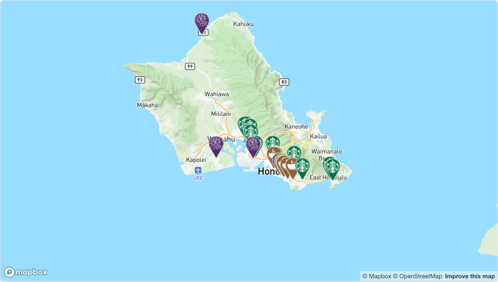
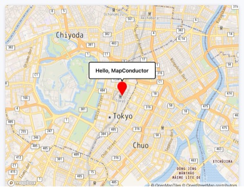

English | [日本語](https://github.com/MapConductor/react-for-mapbox/blob/main/README.ja.md) | [Español (Latinoamérica)](https://github.com/MapConductor/react-for-mapbox/blob/main/README.es-419.md)

# @mapconductor/react-for-mapbox

Mapbox GL JS provider for the MapConductor React SDK. Renders a Mapbox map
through MapConductor's provider-independent camera, marker, and overlay API, so
the same application code can also run on Google Maps, MapLibre, Leaflet,
OpenLayers, ArcGIS, Cesium, or HERE.

## Demo

[](https://demo-react.mapconductor.com/mapbox/map/en)

Open it in the [live demo](https://demo-react.mapconductor.com/mapbox/map/en): the same store map runs on every provider, and the page switches between them. The code, cut down to three stores:

```tsx
import { useMemo, useState } from 'react';
import {
  createGeoPoint,
  createMapCameraPosition,
  createMarkerState,
  type MarkerState,
} from '@mapconductor/js-sdk-core';
import { InfoBubble, Markers } from '@mapconductor/js-sdk-react';
import { MapboxDesign, MapBoxMapView2D, useMapboxViewState } from '@mapconductor/react-for-mapbox';
import '@mapconductor/react-for-mapbox/style.css';

const STORES = [
  { id: 'waikiki', name: 'Waikiki', latitude: 21.2793, longitude: -157.8292 },
  { id: 'kailua', name: 'Kailua', latitude: 21.3972, longitude: -157.7394 },
  { id: 'haleiwa', name: 'Haleiwa', latitude: 21.5928, longitude: -158.1034 },
];

const INITIAL_CAMERA = createMapCameraPosition({
  position: createGeoPoint({ latitude: 21.38, longitude: -157.93 }),
  zoom: 10,
});

export default function App() {
  const mapViewState = useMapboxViewState({
    accessToken: 'YOUR_MAPBOX_ACCESS_TOKEN',
    mapDesignType: MapboxDesign.Streets,
    cameraPosition: INITIAL_CAMERA,
  });
  const [selected, setSelected] = useState<MarkerState | null>(null);
  const markers = useMemo(
    () =>
      STORES.map(store =>
        createMarkerState({
          id: store.id,
          position: createGeoPoint({ latitude: store.latitude, longitude: store.longitude }),
          extra: store,
          onClick: marker => setSelected(marker),
        }),
      ),
    [],
  );

  return (
    <div style={{ width: '100%', height: '100vh' }}>
      <MapBoxMapView2D state={mapViewState} onMapClick={() => setSelected(null)}>
        <Markers states={markers} />
        {selected && (
          <InfoBubble marker={selected}>
            <strong>{(selected.extra as (typeof STORES)[number]).name}</strong>
          </InfoBubble>
        )}
      </MapBoxMapView2D>
    </div>
  );
}
```

Replace `YOUR_MAPBOX_ACCESS_TOKEN` with your own key.

## Installation

```shell
npm install @mapconductor/react-for-mapbox
```

`@mapconductor/js-sdk-core` and `@mapconductor/js-sdk-react` (used for markers and
other shared components) are installed automatically as dependencies. Your
code imports from both directly, so with pnpm's strict (isolated)
`node_modules` — or whenever you prefer to declare everything you import —
install them explicitly instead:

```shell
npm install @mapconductor/react-for-mapbox @mapconductor/js-sdk-core @mapconductor/js-sdk-react
```

`mapbox-gl` is bundled as a dependency. The `mapbox://` style presets require an
access token from your [Mapbox account](https://account.mapbox.com/); the
OSM-based presets work without one.



## Hello Map tutorial

The simplest possible map app, built with MapConductor + Mapbox: click the
marker and a "Hello, MapConductor" bubble pops up. You can build it in the 5
steps below. It uses the openstreetmap.jp styles, which need no access token,
so you can copy-paste and it just works.

### Step 1: Create a React project

Create a React + TypeScript project with Vite.

```shell
npm create vite@latest hello-map -- --template react-ts
cd hello-map
npm install
npm run dev
```

### Step 2: Install MapConductor (Mapbox)

Install the package needed to show a map. We use Mapbox here, but you can use
other map modules too.

```shell
npm install @mapconductor/react-for-mapbox
```

- `@mapconductor/react-for-mapbox` — components / hooks for Mapbox
- `@mapconductor/js-sdk-react` / `@mapconductor/js-sdk-core` are installed
  automatically as dependencies.

### Step 3: Show the map

Create the map state with `useMapboxViewState` and render it with
`<MapBoxMapView2D>`. Don't forget the style CSS import. Give the outer element a
height to make it full-screen.

```tsx
import {
  MapboxDesign,
  MapBoxMapView2D,
  useMapboxViewState,
} from '@mapconductor/react-for-mapbox';
import '@mapconductor/react-for-mapbox/style.css';
import { createGeoPoint, createMapCameraPosition } from '@mapconductor/js-sdk-core';

const TOKYO = createGeoPoint({ latitude: 35.6812, longitude: 139.7671 });
const INITIAL_CAMERA = createMapCameraPosition({ position: TOKYO, zoom: 14 });

export default function App() {
  const mapViewState = useMapboxViewState({
    mapDesignType: MapboxDesign.OsmBrightEn,
    cameraPosition: INITIAL_CAMERA,
  });

  return (
    <div style={{ width: '100vw', height: '100vh' }}>
      <MapBoxMapView2D state={mapViewState} />
    </div>
  );
}
```

Use `MapBoxMapView` instead of `MapBoxMapView2D` for the globe projection.

### Step 4: Place a marker

Create the marker state with `createMarkerState` and register it with
`<Marker>`. Write overlays as **child elements** of the map component.

```tsx
import { useMemo } from 'react';
import { createMarkerState } from '@mapconductor/js-sdk-core';
import { Marker } from '@mapconductor/js-sdk-react';

// ...inside App...
const marker = useMemo(
  () => createMarkerState({ id: 'hello', position: TOKYO }),
  [],
);

// ...inside return...
<MapBoxMapView2D state={mapViewState}>
  <Marker state={marker} />
</MapBoxMapView2D>
```

### Step 5: Show an InfoBubble on click

Track the selected state with `useState`, set it to true in the marker's
`onClick`, and render `<InfoBubble>` only while selected. This is the finished
app.

```tsx
import { useMemo, useState } from 'react';
import {
  MapboxDesign,
  MapBoxMapView2D,
  useMapboxViewState,
} from '@mapconductor/react-for-mapbox';
import '@mapconductor/react-for-mapbox/style.css';
import {
  createGeoPoint,
  createMapCameraPosition,
  createMarkerState,
} from '@mapconductor/js-sdk-core';
import { InfoBubble, Marker } from '@mapconductor/js-sdk-react';

const TOKYO = createGeoPoint({ latitude: 35.6812, longitude: 139.7671 });
const INITIAL_CAMERA = createMapCameraPosition({ position: TOKYO, zoom: 14 });

export default function App() {
  const mapViewState = useMapboxViewState({
    mapDesignType: MapboxDesign.OsmBrightEn,
    cameraPosition: INITIAL_CAMERA,
  });

  const [selected, setSelected] = useState(false);

  const marker = useMemo(
    () => createMarkerState({
      id: 'hello',
      position: TOKYO,
      onClick: () => setSelected(true),
    }),
    [],
  );

  return (
    <div style={{ width: '100vw', height: '100vh' }}>
      <MapBoxMapView2D state={mapViewState} onMapClick={() => setSelected(false)}>
        <Marker state={marker} />
        {selected && (
          <InfoBubble marker={marker}>
            <div style={{ padding: '8px 12px', fontWeight: 600 }}>
              Hello, MapConductor
            </div>
          </InfoBubble>
        )}
      </MapBoxMapView2D>
    </div>
  );
}
```

### Key points

- Coordinates, cameras and markers are created with `js-sdk-core` functions
  (**provider-independent**).
- The map component and hooks come from `react-for-mapbox`
  (**provider-specific**).
- Write overlays as **child elements** of the map component.
- Control show / hide with React `useState`.

## Related packages

- [`@mapconductor/js-sdk-core`](https://github.com/mapconductor/js-sdk-core) — geometry, camera, and state primitives
- [`@mapconductor/js-sdk-react`](https://github.com/mapconductor/js-sdk-react) — shared `Marker`, `Markers`, shapes, and info bubbles
